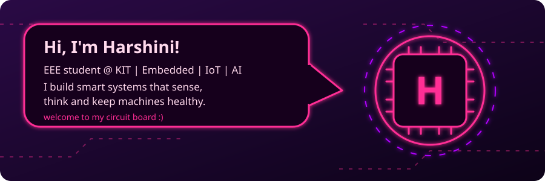
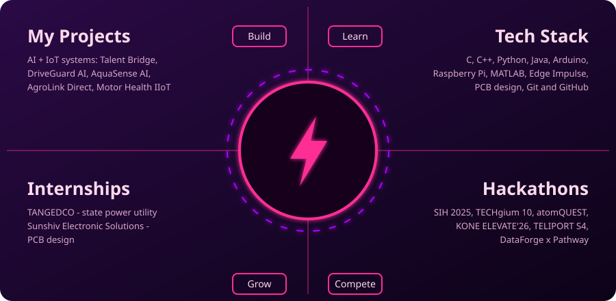

 

  
<h2>Featured Projects</h2>

<table>
  <tr>
    <th>Project</th>
    <th>What it is</th>
    <th>Stack</th>
  </tr>
  <tr>
    <td><a href="https://github.com/Harshini-1021/talentbridge"><b>Talent Bridge</b></a></td>
    <td>AI-powered talent discovery and internal mobility</td>
    <td>TypeScript, AI</td>
  </tr>
  <tr>
    <td><a href="https://github.com/Harshini-1021/edu-portal"><b>Edu Portal</b></a></td>
    <td>Education portal web app</td>
    <td>TypeScript</td>
  </tr>
  <tr>
    <td><a href="https://github.com/Harshini-1021/my-portfolio"><b>My Portfolio</b></a></td>
    <td>Personal portfolio website</td>
    <td>HTML, CSS</td>
  </tr>
  <tr>
    <td><a href="https://github.com/Harshini-1021/Suduko"><b>Suduko</b></a></td>
    <td>Sudoku game</td>
    <td>JavaScript</td>
  </tr>
</table>

  

## Tech Stack

## GitHub Stats

